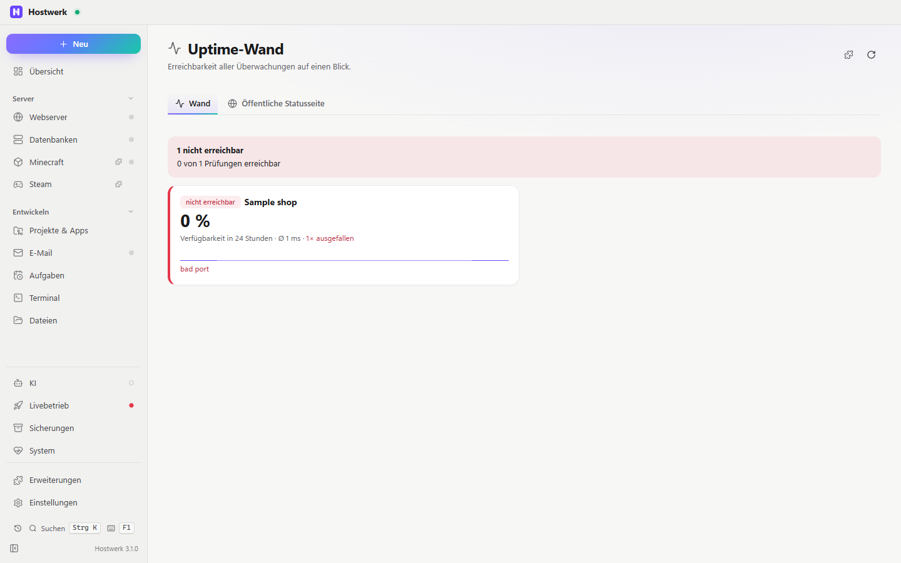

# Uptime-Wand

> **Aufgegangen in der „Status-Wand“ (2.0):** Erreichbarkeit und öffentliche Statusseite sind jetzt Reiter der Status-Wand. Hostwerk installiert sie von selbst und entfernt diese Erweiterung. Hier gibt es keine neuen Fassungen mehr.

Alle Erreichbarkeits-Prüfungen groß und farbig – mit Verlauf der letzten Stunden, Verfügbarkeit, Antwortzeit und Ausfällen. Für einen zweiten Bildschirm, als Kachel oder als öffentliche Statusseite für deine Besucher.

[English](README.md) · Offizielle [Hostwerk](https://github.com/Passimoritz/hostwerk-public)-Erweiterung (läuft abgeschottet, ab Hostwerk 2.9)

## Was sie kann

- **Wo:** Livebetrieb → Betrieb → Uptime-Wand und Übersichtskachel – seit 1.4.0 ohne eigenen Seitenleisten-Eintrag; die ganze Seite bleibt unter Erweiterungen → Öffnen
- **Wand:** jede Prüfung als Kachel mit Zustand, Verfügbarkeit in 24 Stunden, Ø-Antwortzeit, Zahl der Ausfälle und Verlaufslinie (mit Textalternative für Bildschirmleser)
- **Öffentliche Statusseite:** ein geheimer Link (über den Fernzugriff) oder `index.html` + `status.json` jede Minute in einen Website-Ordner. Du wählst, welche Prüfungen erscheinen und unter welchem Namen; Adressen bleiben verborgen, außer du willst sie zeigen. Jede Änderung bestätigst du.
- Noch keine Prüfung? Ein Knopf führt direkt zu *Livebetrieb → Überwachung*.
- Fehlerzustand mit „Erneut versuchen“; nachgeladen wird nur, solange Seite oder Übersicht sichtbar sind.

## Installieren

In Hostwerk: **Erweiterungen → Entdecken** und „Installieren“ klicken. Oder von Hand: die Zip-Datei aus dem [neuesten Release](../../releases/latest) laden → *Erweiterungen → Hinzufügen → Datei*.

Sie läuft abgeschottet in Hostwerk – sie bekommt nur die Rechte, die sie nennt, und Hostwerk zeigt sie vor dem Installieren.

## Rechte

| Recht | Wofür |
|---|---|
| `read:live` | Erreichbarkeit und Verlauf der Prüfungen lesen |
| `share:status` | Öffentliche Statusseite einrichten – **Hostwerk fragt jedes Mal** |

## Entwickeln

Logik in `page/lib.js` (ohne DOM), Tests: `node --test tests/*.test.js`. Prüfung: `node check.js . --strict` (Hostwerk-SDK).

## Lizenz

MIT
