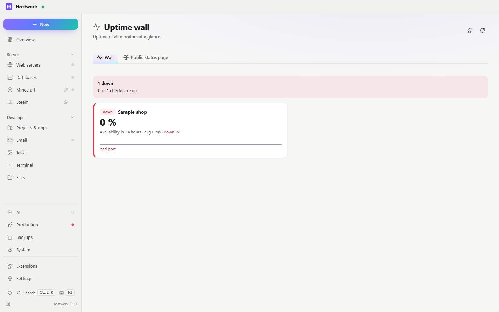

# Uptime wall

> **Merged into the “Status wall” (2.0):** reachability and the public status page are now tabs of the status wall. Hostwerk installs it by itself and removes this extension. There are no new versions here.

All uptime checks big and colourful – with the history of the last hours, availability, response time and outages. For a second screen, as a tile or as a public status page for your visitors.

[Deutsch](README.de.md) · An official [Hostwerk](https://github.com/Passimoritz/hostwerk-public) extension (runs sandboxed, Hostwerk 2.9 or newer)

## What it does

- **Where:** Go live → Operate → Uptime wall and the dashboard tile – no own sidebar entry since 1.4.0; the full page stays under Extensions → Open
- **Wall:** every check as a tile with state, availability over 24 hours, average response time, number of outages and a history line (with a text alternative for screen readers)
- **Public status page:** a secret link (via remote access) or `index.html` + `status.json` written into a website folder every minute. You choose which checks appear and under which name; addresses stay hidden unless you want to show them. You confirm every change.
- No checks yet? A button leads straight to *Live → Monitoring*.
- Error state with “Try again”; refreshes only while the page or the dashboard is visible.

## Install

In Hostwerk: **Extensions → Discover** and click “Install”. Or manually: download the zip from the [latest release](../../releases/latest) → *Extensions → Add → File*.

It runs sandboxed in Hostwerk – it only gets the permissions it lists, and Hostwerk shows them before installing.

## Permissions

| Permission | Why |
|---|---|
| `read:live` | Read uptime checks and their history |
| `share:status` | Set up the public status page – **Hostwerk asks every time** |

## Develop

Logic in `page/lib.js` (no DOM), tests: `node --test tests/*.test.js`. Check: `node check.js . --strict` (Hostwerk SDK).

## License

MIT
